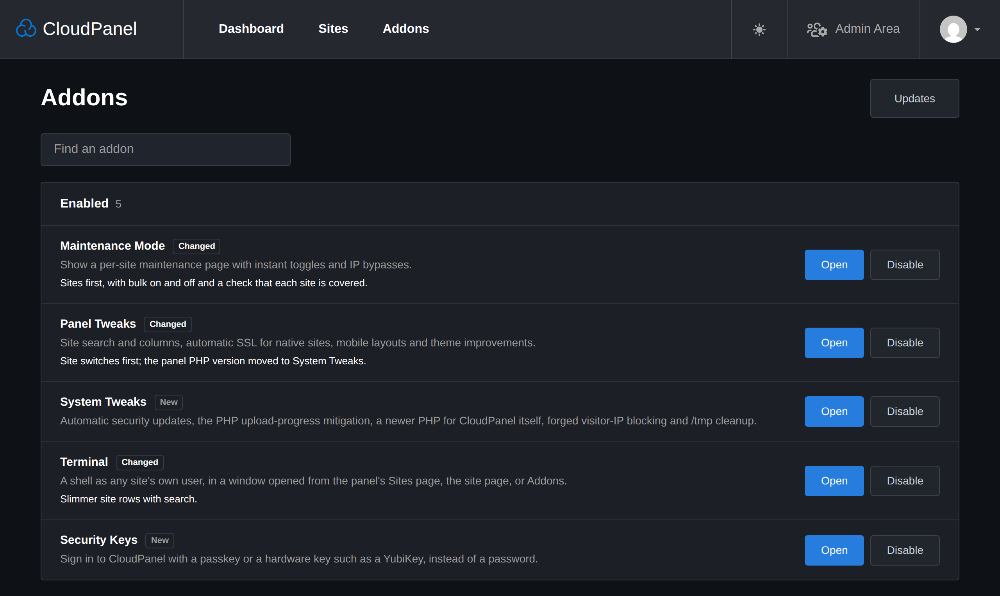

# CloudPanel Addons

Security hardening and extra features for [CloudPanel](https://www.cloudpanel.io/).
[System Tweaks](docs/system-tweaks.md) fixes CloudPanel security weaknesses such
as nginx config injection and forged visitor IPs. See the
[security model and hardening](SECURITY.md).

Unofficial, not affiliated with or endorsed by CloudPanel.

## Install

Log in to your server as **root** and run:

```bash
curl -fsSL https://github.com/7heMech/cloudpanel-addons/releases/latest/download/install.sh | bash
```

To inspect the script first, download it with
`curl -fsSLO https://github.com/7heMech/cloudpanel-addons/releases/latest/download/install.sh`,
review it, and run `bash install.sh` as root.

Checks the download's SHA-256 checksum; updates also check build provenance.
Requires a CloudPanel host that is either x86-64 with AVX2 (Intel 2013+, AMD
2015+) or 64-bit Arm (aarch64). On an x86-64 VM, set the CPU type to `host`.
Instatic CMS is x86-64 only.

When it finishes, open the new **Addons** tab in CloudPanel and enable the
addons you want. System Tweaks is recommended. **Setup** on the addon pages
suggests what to set up next, checked against the server; skip any step you
don't want. Installing enables no addons and leaves site vhosts, MySQL and
firewall rules untouched. It turns off PHP session upload progress on every
PHP-FPM version, sites included, with a graceful reload. See the [FAQ](#faq)
below.



## Addons

| Addon | Description |
| --- | --- |
| [DNS](docs/dns.md) | Each site's Cloudflare or PowerDNS records kept to a profile, with Mailcow set up for its mail. |
| Redirects | Domain and subdomain redirects through Cloudflare Single Redirects or local stand-in sites; a site created at a redirect's domain replaces it. |
| [Firewall](docs/firewall.md) | Cloudflare-only access and visitor IPs for sites, Hetzner Cloud or netcup edge firewalls, a Cloudflare Access gate in front of the panel, and UDP rules on CloudPanel's Firewall page. |
| [Instatic CMS](https://github.com/CoreBunch/Instatic) | Instatic CMS sites on CloudPanel. |
| Stager | Staging copies of WordPress, PHP, static and Instatic sites, and promotion back to live. Based on [clp-stager](https://github.com/7heMech/clp-stager). |
| Maintenance Mode | A customizable 503 page per site, with instant toggles and IP bypasses. |
| [Resource Limits](docs/resource-limits.md) | PHP worker limits by category, assigned in bulk and to new sites, and MySQL and Redis sized to the server's RAM. |
| [SMTP Relay](docs/smtp-relay.md) | Send each site's mail through SMTP relay profiles, WordPress and PHP included. |
| Git Deploy | Deploys from a Git remote, from the panel or from a push. |
| Panel Tweaks | Site search, columns and CSV download, automatic SSL for native sites, mobile layouts, themes and branding. |
| [System Tweaks](docs/system-tweaks.md) | Security hardening, automatic updates, the panel's PHP version, remote backup compression, PHP temp-file cleanup and a server summary at SSH login. |
| [WordPress Tools](docs/wordpress-tools.md) | One-click WordPress sign-in, plugins chosen on the new-site form, optional CLP Varnish Cache installation and MainWP Child enrollment. |
| Terminal | A shell as a site's own user, in its own window, for administrators, and a root shell for the ones root allows. |
| Security Keys | Sign in with a passkey or a hardware key such as a YubiKey instead of a password and two-factor code, for the roles an administrator allows. Needs the panel on a hostname with a valid certificate. |

Only CloudPanel administrators see the Addons tab. Site managers can also use
Git Deploy and create and manage Instatic sites. Other panel users get Panel
Tweaks' site search, columns and CSV download and WordPress sign-in from the
Sites page and site pages, for their own sites. Panel users add their own
security keys under Account → Security, in the roles an administrator allows.

## Manage

| Command | Purpose |
| --- | --- |
| `clp-addons` | As root, toggle addons and run status, repair or update. |
| `clp-addons status` | Check services and CloudPanel integration. |
| `clp-addons enable <addon>` | Enable an addon, installing Docker if it needs it. |
| `clp-addons disable <addon>` | Disable an addon and keep its data. |
| `clp-addons update` | Install the latest verified release. |
| `clp-addons repair` | Restore managed services and CloudPanel integration. |
| `clp-addons share-usage on\|off\|status` | Opt in or out of weekly enabled-addon counts, or print the exact payload. |
| `clp-addons maintenance <domain> [on\|off\|status]` | Control or inspect maintenance mode for a site. |
| `clp-addons terminal root allow <user>` | Let one administrator with 2FA open a root terminal from the panel; `deny` takes it back, and allowing again clears a verification lockout. |
| `clp-addons lock <addon>` | Let the panel switch an addon's protections on but never off (new installs lock System Tweaks); `unlock` reverses it. |

Addon names are `dns`, `redirects`, `firewall`, `instatic`, `stager`, `maintenance`,
`resource-limits`, `git`, `panel-tweaks`, `system-tweaks`, `wp-tools`, `smtp`, `terminal`
and `security-keys`. Run `clp-addons --help` for version selection options.

To remove CloudPanel Addons, disable every addon, then run
`clp-addons self-uninstall --yes`. Sites keep running, Instatic sites included,
and addon data stays in `/var/lib/clp-addons`.

See [Instatic backup and restore](docs/instatic-backups.md) for CloudPanel Remote
Backups.

[When CloudPanel updates](docs/cloudpanel-updates.md) says what the addons do after a CloudPanel update.

## FAQ

### Is CloudPanel Addons safe to use?

Installing enables no addons and leaves site vhosts, MySQL and firewall rules
untouched. Base install turns off PHP session upload progress on every PHP-FPM
version, sites included, with a graceful reload. The web manager runs as the
unprivileged `clp-addons` account with no `sudo` rule of its own behind an
allowlisted root gateway. First installs verify the binary's SHA-256 checksum,
and updates verify both SHA-256 and GitHub build provenance. See
[Is CloudPanel Addons safe to use?](SECURITY.md#is-cloudpanel-addons-safe-to-use)
for details and trust limits.

### Does installing change my sites, MySQL, Nginx, or firewall?

No addons are enabled unless you pass `--addons`. Base install adds the
`clp-addons` binary, unprivileged web manager, allowlisted root gateway on
`/run/clp-addons/auth.sock`, the admin-only **Addons** link and `/addons/`
proxy block in CloudPanel's panel vhost (tested with `nginx -t` and rolled back
on failure), and `99-clp-addons-upload-progress.ini` in every
`/etc/php/<ver>/fpm/conf.d` (`session.upload_progress.enabled = Off`,
mitigating CVE-2026-109619 and CVE-2026-115560, tested with `php-fpm -t` and
rolled back on failure before a graceful reload). Site vhosts, MySQL, firewall
rules, SSH config, Docker and Postfix stay untouched.

### Does System Tweaks or another addon restart MySQL or break existing setups?

No addon runs until you enable it. After enabling
[System Tweaks](docs/system-tweaks.md), these stay off until you switch them
on: **MySQL on this server only**, **Block SSH login guessing**, **Install
updates automatically**, and **Compress remote backups with Zstandard**.
**Panel PHP** keeps CloudPanel's current version unless you pick a newer
installed PHP. Both MySQL loopback binding and Panel PHP run pre-checks and
roll back automatically if the service fails to come back.

System Tweaks' default protections change some behaviour: sites behind a
non-Cloudflare public proxy lose visitor IPs, site users can no longer run
`clpctl db:import`, and repeated failed logins on the panel's custom domain
block an address from HTTPS on every site for an hour (also starting `fail2ban`
if it is installed but stopped). Read [System Tweaks](docs/system-tweaks.md)
before enabling it.

### Can I uninstall, and what happens when CloudPanel updates?

CloudPanel's panel templates and master vhost keep pristine copies and SHA-256
baselines. Disable every addon with `clp-addons disable <addon>` as root (the
Addons page cannot disable a locked System Tweaks until you run `clp-addons
unlock system-tweaks`), then run `clp-addons self-uninstall --yes` to restore
CloudPanel's files and remove the binary, units and PHP-FPM drop-in. Sites keep
running; the `clp-addons` account, `/etc/clp-addons`, `/var/backups/clp-addons`
and `/var/lib/clp-addons` stay on disk. CloudPanel updates are never held back;
unrecognized upstream file changes pause only the affected block until checked.

## Develop

Requires Bun 1.4.5-canary.20261119.1 (`npm install -g bun@1.4.5-canary.20261119.1`) and ShellCheck.

```bash
bun install
bun run typecheck
bun run test
bun run lint:install
bun run build
```

Run `bun run preview:ui` to preview the interface at
`http://localhost:4100/addons/` with sample data.

Pull requests target `dev`. A pull request and `dev` itself each deploy to the
staging CloudPanel box, so a change can be tried on a real panel; `main` is what
gets tagged and released.

Architecture and security choices are indexed in
[Decisions](docs/DECISIONS.md).

## Acknowledgments

Thanks to [@ccMatrix](https://github.com/ccMatrix) for the CloudPanel SSO and
Nginx reverse proxy integration concept.

## License

[Apache-2.0](LICENSE).
