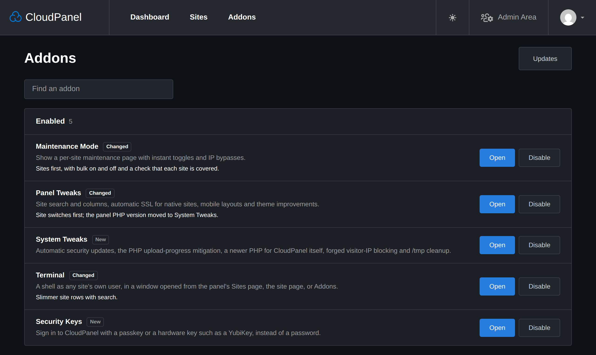

# CloudPanel Addons

Extra features for [CloudPanel](https://www.cloudpanel.io/): staging copies,
maintenance pages, Git deploys, one-click WordPress sign-in, and more. You sign
in with your existing CloudPanel login.

This is an unofficial project, not affiliated with or endorsed by CloudPanel.

## Install

Log in to your server as **root** and run:

```bash
curl -fsSL https://github.com/7heMech/cloudpanel-addons/releases/latest/download/install.sh | bash
```

The installer asks which addons you want, and installs Docker or Postfix when a
selected addon needs it. Updates are checked against GitHub build provenance.
Requires an x86-64 CloudPanel host.

When it finishes, open the new **Addons** tab in CloudPanel.



## Addons

| Addon | Description |
| --- | --- |
| Cloudflare IP Access | Allow traffic from Cloudflare only, across all sites and for new ones. |
| [DNS](docs/dns.md) | Each site's Cloudflare records kept to a profile, with Mailcow set up for its mail, and redirect domains. |
| [Instatic CMS](https://github.com/CoreBunch/Instatic) | Instatic CMS sites on CloudPanel. |
| Stager | Staging copies of WordPress, PHP, static and Instatic sites, and promotion back to live. Based on [clp-stager](https://github.com/7heMech/clp-stager). |
| Maintenance Mode | A customizable 503 page per site, with instant toggles and IP bypasses. |
| PHP Resources | Categories of PHP-FPM worker limits, assigned in bulk and to new sites. |
| [SMTP Relay](docs/smtp-relay.md) | Send each site's mail through SMTP relay profiles, WordPress and PHP included. |
| Git Deploy | Deploys from a Git remote, from the panel or from a push. |
| Panel Tweaks | Site search, columns and CSV download, automatic SSL for native sites, mobile layouts and themes. |
| [System Tweaks](docs/system-tweaks.md) | Automatic security updates, the panel’s PHP version, the PHP upload-progress mitigation, forged visitor-IP blocking, clearing abandoned PHP temp files from /tmp, and UDP rules on CloudPanel's Firewall page. |
| [WordPress Tools](docs/wordpress-tools.md) | One-click WordPress sign-in, plugins chosen on the new-site form, optional CLP Varnish Cache installation and MainWP Child enrollment. |
| Terminal | A shell as a site's own user, in its own window, for administrators. |
| Security Keys | Sign in with a passkey or a hardware key such as a YubiKey instead of a password and two-factor code, for the roles an administrator allows. Needs the panel on a hostname with a valid certificate. |

Only CloudPanel administrators see the Addons tab. Site managers can also use
Git Deploy and create and manage Instatic sites. Other panel users get Panel
Tweaks' site search, columns and CSV download and WordPress sign-in from the
Sites page and site pages, for their own sites. Panel users add their own
security keys under Account → Security, in the roles an administrator allows.

## Manage

| Command | Purpose |
| --- | --- |
| `clp-addons` | As root, toggle addons and run status, repair or update. |
| `clp-addons status` | Check services and CloudPanel integration. |
| `clp-addons install <addon>` | Enable an addon, installing Docker if it needs it. |
| `clp-addons update` | Install the latest verified release. |
| `clp-addons repair` | Restore managed services and CloudPanel integration. |
| `clp-addons maintenance <domain> [on\|off\|status]` | Control or inspect maintenance mode for a site. |
| `clp-addons uninstall <addon> --yes` | Remove an addon and keep its data. |

Addon names are `cloudflare-ips`, `dns`, `instatic`, `stager`, `maintenance`,
`php-resources`, `git`, `panel-tweaks`, `system-tweaks`, `wp-tools`, `smtp`, `terminal`
and `security-keys`. Run
`clp-addons --help` for version selection and data removal options.

See [Instatic backup and restore](docs/instatic-backups.md) for CloudPanel Remote
Backups.

## Develop

Requires Bun 1.4.4 and ShellCheck.

```bash
bun install
bun run typecheck
bun run test
bun run lint:install
bun run build
```

Run `bun run preview:ui` to preview the interface at
`http://localhost:4100/addons/` with sample data.

Pull requests target `dev`. A pull request and `dev` itself each deploy to the
staging CloudPanel box, so a change can be tried on a real panel; `main` is what
gets tagged and released.

Architecture and security choices are indexed in
[Decisions](docs/DECISIONS.md).

## Acknowledgments

Thanks to [@ccMatrix](https://github.com/ccMatrix) for the CloudPanel SSO and
Nginx reverse proxy integration concept.

## License

[Apache-2.0](LICENSE).
