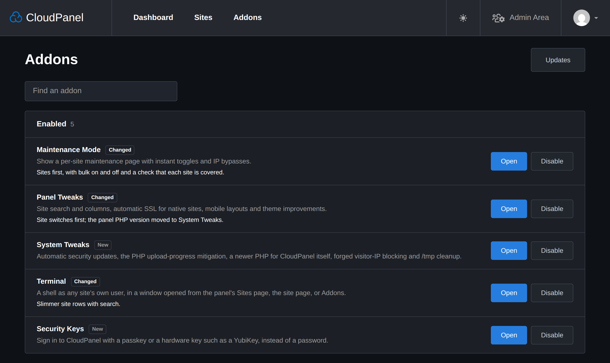

# CloudPanel Addons

Security hardening and extra features for [CloudPanel](https://www.cloudpanel.io/).
[System Tweaks](docs/system-tweaks.md) fixes CloudPanel security weaknesses such
as nginx config injection and forged visitor IPs. See the
[security model and hardening](SECURITY.md).

Unofficial, not affiliated with or endorsed by CloudPanel.

## Install

Log in to your server as **root** and run:

```bash
curl -fsSL https://github.com/7heMech/cloudpanel-addons/releases/latest/download/install.sh | bash
```

Checks the download's SHA-256 checksum; updates also check build provenance.
Requires an x86-64 CloudPanel host with AVX2 (Intel 2013+, AMD 2015+). On a VM,
set the CPU type to `host`.

When it finishes, open the new **Addons** tab in CloudPanel and enable the
addons you want. System Tweaks is recommended.



## Addons

| Addon | Description |
| --- | --- |
| [DNS](docs/dns.md) | Each site's Cloudflare records kept to a profile, with Mailcow set up for its mail, and redirect domains. |
| [Firewall](docs/firewall.md) | Allow traffic from Cloudflare only, across all sites and for new ones, and UDP rules on CloudPanel's Firewall page. |
| [Instatic CMS](https://github.com/CoreBunch/Instatic) | Instatic CMS sites on CloudPanel. |
| Stager | Staging copies of WordPress, PHP, static and Instatic sites, and promotion back to live. Based on [clp-stager](https://github.com/7heMech/clp-stager). |
| Maintenance Mode | A customizable 503 page per site, with instant toggles and IP bypasses. |
| [Resource Limits](docs/resource-limits.md) | PHP worker limits by category, assigned in bulk and to new sites, and MySQL and Redis sized to the server's RAM. |
| [SMTP Relay](docs/smtp-relay.md) | Send each site's mail through SMTP relay profiles, WordPress and PHP included. |
| Git Deploy | Deploys from a Git remote, from the panel or from a push. |
| Panel Tweaks | Site search, columns and CSV download, automatic SSL for native sites, mobile layouts, themes and branding. |
| [System Tweaks](docs/system-tweaks.md) | Security hardening, automatic updates, the panel's PHP version, remote backup compression, PHP temp-file cleanup and a server summary at SSH login. |
| [WordPress Tools](docs/wordpress-tools.md) | One-click WordPress sign-in, plugins chosen on the new-site form, optional CLP Varnish Cache installation and MainWP Child enrollment. |
| Terminal | A shell as a site's own user, in its own window, for administrators, and a root shell for the ones root allows. |
| Security Keys | Sign in with a passkey or a hardware key such as a YubiKey instead of a password and two-factor code, for the roles an administrator allows. Needs the panel on a hostname with a valid certificate. |

Only CloudPanel administrators see the Addons tab. Site managers can also use
Git Deploy and create and manage Instatic sites. Other panel users get Panel
Tweaks' site search, columns and CSV download and WordPress sign-in from the
Sites page and site pages, for their own sites. Panel users add their own
security keys under Account → Security, in the roles an administrator allows.

## Manage

| Command | Purpose |
| --- | --- |
| `clp-addons` | As root, toggle addons and run status, repair or update. |
| `clp-addons status` | Check services and CloudPanel integration. |
| `clp-addons enable <addon>` | Enable an addon, installing Docker if it needs it. |
| `clp-addons disable <addon>` | Disable an addon and keep its data. |
| `clp-addons update` | Install the latest verified release. |
| `clp-addons repair` | Restore managed services and CloudPanel integration. |
| `clp-addons maintenance <domain> [on\|off\|status]` | Control or inspect maintenance mode for a site. |
| `clp-addons terminal root allow <user>` | Let one administrator with 2FA open a root terminal from the panel; `deny` takes it back, and allowing again clears a verification lockout. |
| `clp-addons lock <addon>` | Let the panel switch an addon's protections on but never off (new installs lock System Tweaks); `unlock` reverses it. |

Addon names are `dns`, `firewall`, `instatic`, `stager`, `maintenance`,
`resource-limits`, `git`, `panel-tweaks`, `system-tweaks`, `wp-tools`, `smtp`, `terminal`
and `security-keys`. Run `clp-addons --help` for version selection options.

To remove CloudPanel Addons, disable every addon, then run
`clp-addons self-uninstall --yes`. Sites keep running, Instatic sites included,
and addon data stays in `/var/lib/clp-addons`.

See [Instatic backup and restore](docs/instatic-backups.md) for CloudPanel Remote
Backups.

[When CloudPanel updates](docs/cloudpanel-updates.md) says what the addons do after a CloudPanel update.

## Develop

Requires Bun 1.4.4-canary.20261108.1 (`npm install -g bun@1.4.4-canary.20261108.1`) and ShellCheck.

```bash
bun install
bun run typecheck
bun run test
bun run lint:install
bun run build
```

Run `bun run preview:ui` to preview the interface at
`http://localhost:4100/addons/` with sample data.

Pull requests target `dev`. A pull request and `dev` itself each deploy to the
staging CloudPanel box, so a change can be tried on a real panel; `main` is what
gets tagged and released.

Architecture and security choices are indexed in
[Decisions](docs/DECISIONS.md).

## Acknowledgments

Thanks to [@ccMatrix](https://github.com/ccMatrix) for the CloudPanel SSO and
Nginx reverse proxy integration concept.

## License

[Apache-2.0](LICENSE).
